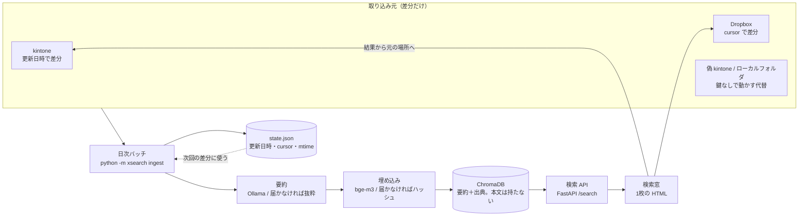
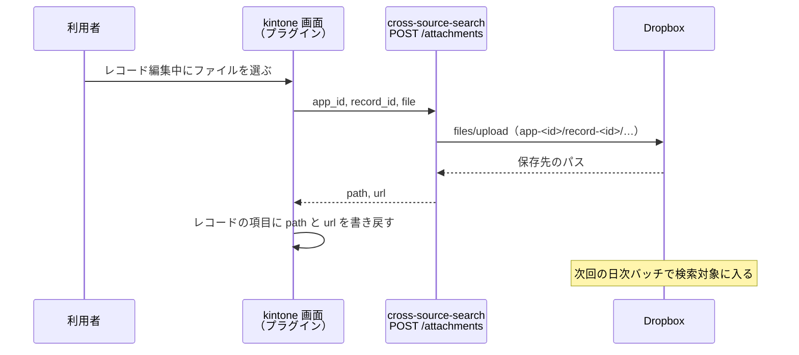

# cross-source-search

**Cross-source semantic search for scattered office data.** Pulls only the changes from several stores (kintone records, Dropbox files), summarizes each item with a local LLM, stores the summaries in ChromaDB and exposes one search box so people stop caring where a document lives. Runs with no external accounts thanks to a bundled fake kintone server and a local-folder source.

[](https://github.com/ikkeiman/cross-source-search/actions/workflows/ci.yml)

## これは何か

社内情報が kintone のレコードと Dropbox のファイルに分かれていると、kintone はアプリ・レコード単位、Dropbox はフォルダをたどる探し方しかなく、「どちらにあるか分からない情報」は事実上見つけられません。このリポジトリは、複数の保管場所から**変更分だけ**を毎日取り込み、1件ずつ**ローカル LLM で要約**して ChromaDB に入れ、**1つの検索窓**から保管場所を意識せずに探せるようにする最小実装です。

約100名規模の組織で、kintone と Dropbox に分かれた社内情報を横断検索する基盤を設計・運用した経験をもとに、同じ構成を一般化して一から作り直したものです。会社固有のデータ・ルール・コードは含みません。

あわせて、kintone の画面でファイルを選ぶだけで Dropbox 側に保存され、レコードに保存先が書き戻される **kintone プラグイン**の参照実装を同梱しています（API 側はテスト済み、プラグイン本体は kintone 環境で未検証）。

## 構成





- 取り込み元は `Source.fetch_changes(state) -> (changes, new_state)` という1つの形に揃える。差分の取り方の違い（kintone は更新日時、Dropbox は cursor、フォルダは mtime）はその中に閉じ込める
- ベクトル DB に入れるのは**要約と出典**だけ。本文の全文は持たない
- 要約と埋め込みはローカル LLM（Ollama）。届かない環境では抜粋とハッシュ埋め込みに自動で切り替わり、どちらを使ったかを `/healthz` と取り込みログに残す

## 動かし方

### uv だけで（Ollama なし。要約は抜粋、埋め込みはハッシュ）

```bash
git clone https://github.com/ikkeiman/cross-source-search.git
cd cross-source-search
uv sync --dev
uv run python -m xsearch fake-kintone &        # 偽 kintone（:8002）。合成データ 3 アプリ 90 レコード
uv run python -m xsearch ingest                # 取り込み。2回目以降は差分だけ
uv run python -m xsearch search "請求書 保管期間"
uv run python -m xsearch serve                 # http://localhost:8000 に検索窓
```

Windows（PowerShell）では `&` の代わりにターミナルをもう1つ開いて `uv run python -m xsearch fake-kintone` を実行してください。

### Ollama を使う（要約と意味検索が本来の形になる）

```bash
ollama pull qwen2.5:7b-instruct   # 要約
ollama pull bge-m3                # 埋め込み（多言語。日本語に強い）
uv run python -m xsearch ingest --full
```

### docker compose

```bash
docker compose up -d --build
docker compose exec ollama ollama pull qwen2.5:7b-instruct
docker compose exec ollama ollama pull bge-m3
docker compose exec search uv run --no-sync python -m xsearch ingest
```

### 本物の kintone / Dropbox に向ける

`.env.example` を `.env` にコピーし、`SOURCES=kintone,dropbox` と各トークンを設定します。`.env` はコミットしないでください。kintone は API トークン（アプリごと）、Dropbox はアクセストークンが必要です。**どちらも実アカウントでは動作確認していません**（後述）。

## 設計判断

**差分だけを取り込む。** 全件を毎日取り直すと、要約の LLM 呼び出しが件数ぶん毎回かかります。kintone は「前回見た最大の更新日時より後」を更新日時の昇順で取り、Dropbox は API が返す cursor を保存して `list_folder/continue` で変更分だけを受け取り、フォルダはファイルの更新時刻とサイズで判定します。削除は Dropbox なら cursor 経由で届き、kintone は API からは分からないので `--full` のときに ID を突き合わせて反映します。取り込み元ごとに state を保存するので、途中で落ちてもやり直しが最小で済みます。

**ベクトル DB に本文を置かない。** 入れるのは要約・タイトル・出典（URL、更新日時、種類）と短い抜粋だけです。検索結果から元の kintone レコードや Dropbox のファイルに戻れればよく、本文のコピーを増やすほど権限管理と漏えい時の影響が重くなるためです。要約を検索対象にすると、長い議事録でも「何の話か」で当たります。

**要約をローカル LLM で行う。** 社内文書を外部の API に送らずに済みます。モデルが無い環境では抜粋に切り替え、取り込みログに `summarizer: excerpt` と残して、後からモデルありで `--full` し直せるようにしています。

**プラグインで Dropbox を意識させない。** 利用者に「ファイルは Dropbox のこのフォルダに置いて、パスを kintone に貼ってください」と頼むと続きません。kintone の画面でファイルを選ぶだけで保存され、保存先が自動で書き戻されるので、運用ルールを増やさずに Dropbox 側へファイルが集まり、そのまま検索対象になります。

**意味検索にキーワードを少し足す。** 埋め込みだけだと、固有の語（型番、件名の一部）を含む文書が上に来ないことがあります。ベクトルで候補を取ったあと、クエリの語をすべて含むものを少し持ち上げています。

## 動作確認

合成データ（kintone 3 アプリ 90 レコード、ファイル 12 件。すべて架空）で、Ollama なし（抜粋要約・ハッシュ埋め込み）の環境での結果です。

| 操作 | 結果 |
|---|---|
| 1回目の取り込み | 102 件 upsert、0.6 秒 |
| 2回目の取り込み | 0 件（差分なし） |
| `search "請求書 保管期間"` | 申請・議事録のレコードが上位。語一致が付く |
| `search "在宅勤務の申請方法"` | 問い合わせ・申請のレコードと、手順書のファイルが混ざって上位 |
| ローカルフォルダの追加・更新・削除 | 次回の取り込みで upsert / delete に反映（テストで固定） |
| Dropbox の cursor | 初回 `list_folder` → 以後 `continue` だけ。削除エントリも反映（MockTransport で固定） |

精度の数字は出していません。ハッシュ埋め込みは意味を捉えないので、意味検索の質は Ollama + bge-m3 で動かしたときに初めて評価できます。

## 設定リファレンス

| 変数 | 意味 | 既定 |
|---|---|---|
| `SOURCES` | 使う取り込み元。`fake_kintone`, `local_folder`, `kintone`, `dropbox` | `fake_kintone,local_folder` |
| `KINTONE_BASE_URL` / `KINTONE_API_TOKENS` / `KINTONE_APP_IDS` | kintone。トークンは `app_id:token` をカンマ区切り | |
| `DROPBOX_ACCESS_TOKEN` / `DROPBOX_ROOT_PATH` | Dropbox。ルートパス配下を再帰的に見る | `/shared` |
| `FAKE_KINTONE_URL` / `LOCAL_FOLDER_PATH` | 代替の取り込み元 | `http://127.0.0.1:8002` / `sample_data/files` |
| `OLLAMA_BASE_URL` / `SUMMARY_MODEL` / `EMBED_MODEL` | 要約と埋め込み | `qwen2.5:7b-instruct` / `bge-m3` |
| `DATA_DIR` | ChromaDB、state.json、取り込みログ、添付の保存先 | `data` |

コマンド: `python -m xsearch fake-kintone | ingest [--full] | search "語" | serve`。合成データの作り直しは `python scripts/make_sample_data.py --seed 42`。

## やっていないこと・制約

- **権限の制御がありません。** 検索窓を開ける人は全件を検索できます。実運用では、取り込み時に閲覧権限を metadata に持たせ、検索時に利用者の所属で絞る必要があります。このリポジトリの範囲外です
- **本物の kintone と Dropbox では動作確認していません。** kintone は同梱の偽サーバーに対して、Dropbox は MockTransport に対してテストしています。API の形は公式ドキュメントに合わせていますが、認証やレート制限、`offset` の上限（kintone は 10,000）を超えるアプリへの対応は未実装です
- **Ollama を使った要約・埋め込みは、この README を書いた環境では実行していません。** テストはすべて抜粋・ハッシュで通しています
- **kintone プラグインは参照実装です。** 設定画面、CORS、パッケージ化と署名鍵の管理は含みません。詳細は `plugin/README.md`
- **本番運用はしていません。** 認証、HTTPS、バッチのスケジューラ（cron やタスクスケジューラ）は含みません
- 対応するファイルは .txt .md .csv .docx .pdf。Excel や画像の中身は読みません
- 日本語前提です（要約プロンプト、埋め込みモデルの選定）

## 開発

```bash
uv sync --dev
uv run ruff check . && uv run ruff format --check .
uv run pytest -q
```

## ライセンス

MIT
